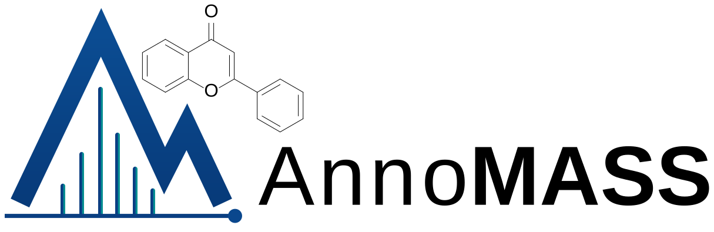
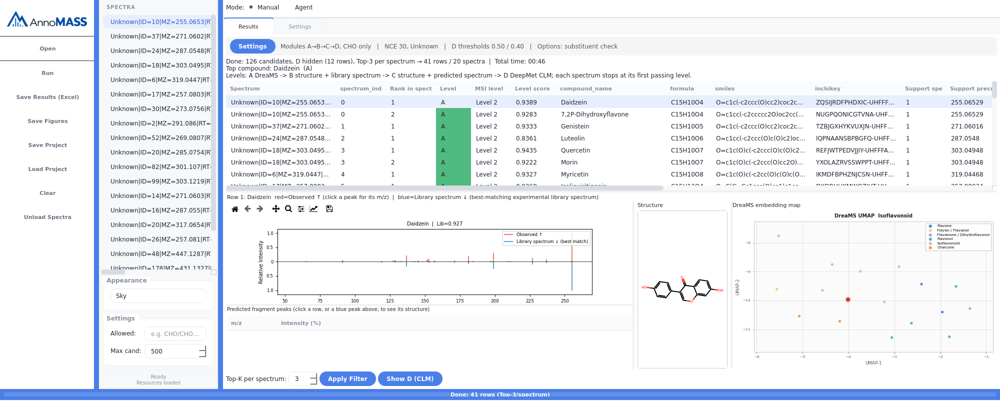
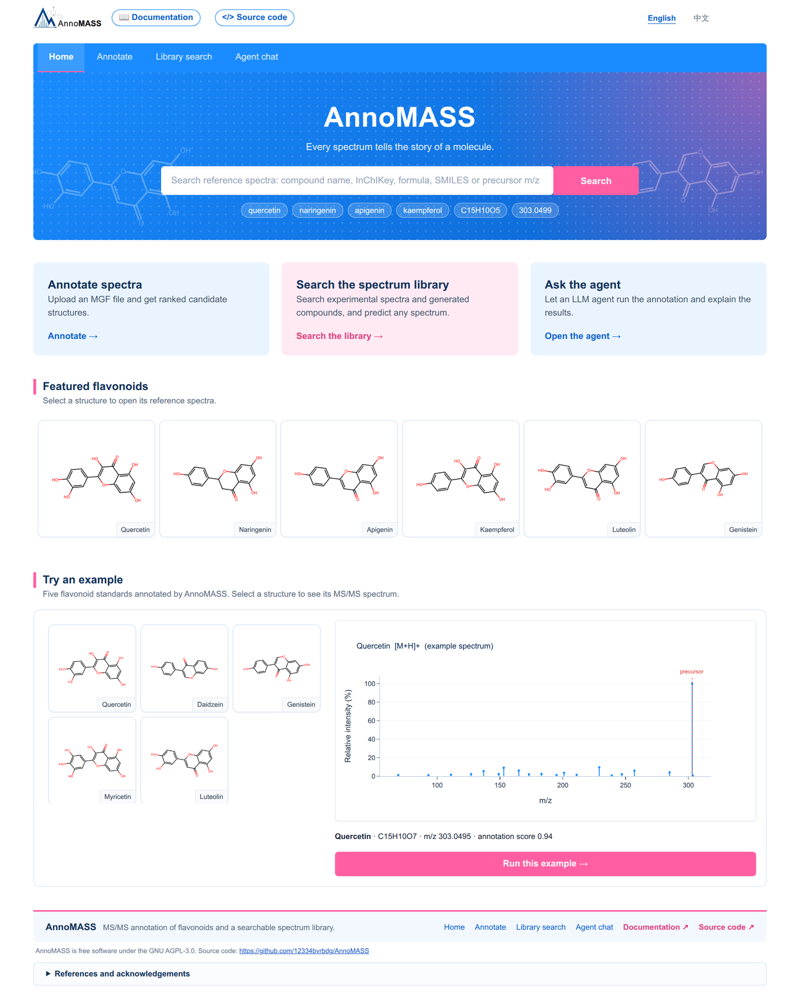

<p align="center">
  
</p>

<h3 align="center">Tiered MS/MS annotation of flavonoids</h3>

<p align="center">
  <a href="https://annomass.com"></a>
  <a href="https://annomass.readthedocs.io/"></a>
  <a href="https://github.com/12334bvrbdg/AnnoMASS/releases/latest"></a>
  <a href="LICENSE"></a>
  
  
  
</p>

<p align="center">
  <a href="#install">Install</a> ·
  <a href="#use-annomass">Use</a> ·
  <a href="#downloads">Downloads</a> ·
  <a href="#3-screen-flavonoids-from-other-structure-databases">Flavonoid screening</a> ·
  <a href="https://annomass.readthedocs.io">Documentation</a> ·
  <a href="#references">References</a>
</p>

---

**AnnoMASS** annotates flavonoid structures from positive-mode LC-MS/MS spectra. Levels A–C
are applied in order, and a spectrum stops at the first level that gives a candidate above its
score threshold. Level D proposes generated structures for any spectrum as an extra output.
Every result carries a confidence level mapped to the MSI levels.

| Level | Evidence | MSI level |
|:---:|---|:---:|
| **A** | Match to an experimental reference spectrum (spectral-embedding library match) | 2 |
| **B** | Structure-library inference + experimental spectrum of the candidate | 2 |
| **C** | Structure-library inference + predicted spectrum | 3 |
| **D** | Generated structure + predicted spectrum | 4 |

**What you get**

- :microscope: **Flavonoid-focused libraries**: a reference spectral library, an experimental spectral library and a structure library of 18,254 flavonoids, ready to download
- :desktop_computer: **Three ways to run**: desktop GUI, command line, and the web app at [annomass.com](https://annomass.com)
- :package: **One-line install**: the installer sets up all environments and downloads all weights and libraries
- :test_tube: **Your own structure library**: screen flavonoids from DeepMASS2, PubChem, COCONUT or any SMILES list with the same rules

## Use AnnoMASS

| | |
|---|---|
| :globe_with_meridians: **Web version** | <https://annomass.com>: no installation, up to 100 spectra per file |
| :book: **Documentation** | <https://annomass.readthedocs.io>: installation, GUI and CLI tutorials, algorithm |
| :computer: **Local installation** | see [Install](#install) below |

### Desktop GUI

<p align="center"></p>

### Web version

<p align="center"></p>

## Install

Linux (Ubuntu 22.04 or later) or Windows 10/11 with WSL2:

```bash
git clone https://github.com/12334bvrbdg/AnnoMASS.git
cd AnnoMASS
bash release_files/installer/install.sh
```

The installer builds three Python environments under `~/AnnoMASS`, fetches the third-party
code at the commits used for the paper, and downloads all model weights, spectral libraries and
structure libraries (about 3.7 GB) from the [Releases](https://github.com/12334bvrbdg/AnnoMASS/releases)
page. The first run takes 20–60 minutes. Details: [installation guide](https://annomass.readthedocs.io/en/latest/installation/).

Test it on the five example spectra, then start the GUI:

```bash
annomass headless --mgf examples/example_5_spectra.mgf --out test_result.xlsx --top-n 3
annomass
```

## Downloads

### 1. Model weights and libraries (Release v1.0.0)

All files are on the [Releases](https://github.com/12334bvrbdg/AnnoMASS/releases/tag/v1.0.0) page.
The installer downloads them for you (`release_files/installer/download_data.sh`).

| File | Content |
|---|---|
| `MassSpecGym_DreaMS_flavonoid_only.hdf5` | Flavonoid reference spectral library with spectral embeddings (level A) |
| `references_spectrums_positive.pickle`, `references_spectrums_negative.pickle` | Experimental flavonoid spectral library (level B) |
| `references_index_positive_spec2vec.bin`, `references_index_negative_spec2vec.bin` | Search index of the spectral library |
| `spec2vec_spectraverse_positive.model`, `spec2vec_spectraverse_negative.model` (+ `.npy` files) | Spectral-similarity model weights |
| `FlavonoidStructureDB-dedup.csv` | Flavonoid structure library, 18,254 structures |
| `flavonoid_candidates_final.csv` | Generated flavonoid structures (level D) |
| `CFIL_extended.csv`, `TPIL_extended.xlsx` | Diagnostic fragment libraries |
| `ssl_model.ckpt`, `embedding_model.ckpt` | DreaMS pretrained weights (copy of Zenodo [10997887](https://zenodo.org/records/10997887)) |
| `msg_all.zip` | ICEBERG MassSpecGym-trained weights (copy of the model linked in the [ms-pred README](https://github.com/coleygroup/ms-pred)) |
| `SHA256SUMS.txt` | Checksums |

The DreaMS and ICEBERG weights are unchanged copies of the files published by their authors.
Please cite the original papers (references 1 and 5–6) when you use them.

### 2. Example spectra

`examples/example_5_spectra.mgf`: five positive-mode spectra of flavonoid standards (daidzein, genistein,
luteolin, quercetin, myricetin).

### 3. Screen flavonoids from other structure databases

`flavonoid_screening/screen_flavonoids.py` applies the rules that built the AnnoMASS structure
library to any structure table (DeepMASS2 structure database, PubChem, COCONUT, or your own
list). See [flavonoid_screening/README.md](flavonoid_screening/README.md).

```bash
curl -LO https://github.com/hcji/DeepMASS2_GUI/releases/download/v0.99.1/DeepMassStructureDB-v1.1.csv
python flavonoid_screening/screen_flavonoids.py --input DeepMassStructureDB-v1.1.csv --out flavonoids.csv --workers 6
```

### 4. Public spectral databases

The AnnoMASS libraries were built from these public resources. You do not need to download
them to run AnnoMASS.

| Database | Link |
|---|---|
| MassSpecGym | [Hugging Face dataset](https://huggingface.co/datasets/roman-bushuiev/MassSpecGym) |
| Spectraverse v1.0.1 | [Zenodo 10.5281/zenodo.17870921](https://doi.org/10.5281/zenodo.17870921) |
| DeepMASS2 reference data | [DeepMASS2 release v0.99.1](https://github.com/hcji/DeepMASS2_GUI/releases/tag/v0.99.1) |
| GNPS | <https://gnps.ucsd.edu> |
| MoNA | <https://mona.fiehnlab.ucdavis.edu> |

## Methods AnnoMASS builds on

| Method | Role in AnnoMASS | Code |
|---|---|---|
| DreaMS | Spectral embedding, library matching (level A) | [pluskal-lab/DreaMS](https://github.com/pluskal-lab/DreaMS) |
| DeepMASS2 | Structure-library inference (levels B and C) | [hcji/DeepMASS2_GUI](https://github.com/hcji/DeepMASS2_GUI) |
| Spec2Vec, matchms | Spectral similarity and spectrum processing | [iomega/spec2vec](https://github.com/iomega/spec2vec), [matchms/matchms](https://github.com/matchms/matchms) |
| ICEBERG | Fragmentation and spectrum prediction (levels C and D) | [coleygroup/ms-pred](https://github.com/coleygroup/ms-pred) |
| CLM, REINVENT4 | Chemical language model for generated structures (level D) | [skinniderlab/CLM](https://github.com/skinniderlab/CLM), [MolecularAI/REINVENT4](https://github.com/MolecularAI/REINVENT4) |
| AnnoSM | Substituent-position check | [YangHuaLab/AnnoSM](https://github.com/YangHuaLab/AnnoSM) |
| ABCoRT | Retention-time prediction (optional) | [RiverCCC/ABCoRT](https://github.com/RiverCCC/ABCoRT) |
| RDKit | Chemistry toolkit | [rdkit.org](https://www.rdkit.org) |

## References

1. Bushuiev, R. et al. Self-supervised learning of molecular representations from millions of tandem mass spectra using DreaMS. *Nature Biotechnology* **44**, 630–640 (2026). https://doi.org/10.1038/s41587-025-02663-3
2. Bushuiev, R. et al. MassSpecGym: a benchmark for the discovery and identification of molecules. *Advances in Neural Information Processing Systems* **37**, 110010–110027 (2024). https://doi.org/10.48550/arXiv.2410.23326
3. Huber, F. et al. Spec2Vec: improved mass spectral similarity scoring through learning of structural relationships. *PLoS Computational Biology* **17**, e1008724 (2021). https://doi.org/10.1371/journal.pcbi.1008724
4. Huber, F. et al. matchms – processing and similarity evaluation of mass spectrometry data. *Journal of Open Source Software* **5**, 2411 (2020). https://doi.org/10.21105/joss.02411
5. Goldman, S., Li, J. & Coley, C. W. Generating molecular fragmentation graphs with autoregressive neural networks. *Analytical Chemistry* **96**, 3419–3428 (2024). https://doi.org/10.1021/acs.analchem.3c04654
6. Wang, R. et al. Neural spectral prediction for structure elucidation with tandem mass spectrometry. *bioRxiv* 2025.05.28.656653 (2025). https://doi.org/10.1101/2025.05.28.656653
7. Loeffler, H. H. et al. Reinvent 4: modern AI-driven generative molecule design. *Journal of Cheminformatics* **16**, 20 (2024). https://doi.org/10.1186/s13321-024-00812-5
8. Schymanski, E. L. et al. Identifying small molecules via high resolution mass spectrometry: communicating confidence. *Environmental Science & Technology* **48**, 2097–2098 (2014). https://doi.org/10.1021/es5002105

## License

AnnoMASS is released under the [GNU Affero General Public License v3.0](LICENSE).
Part of the code in `core/` is derived from [DeepMASS2](https://github.com/hcji/DeepMASS2_GUI)
(AGPL-3.0). `cdk-2.2.jar` is the [Chemistry Development Kit](https://cdk.github.io) (LGPL-2.1).
The DreaMS and ICEBERG weights in the Release keep the MIT licenses of their projects.

## Citation

The AnnoMASS paper is in preparation. Citation details will be added here.

## Repository contents

| Path | Content |
|---|---|
| `release_files/installer/` | Installer (`install.sh`, `download_data.sh`, Windows `.bat` files), environment files, patches |
| `annomass_app.py`, `launch_gui.py`, `uic/`, `ui/` | Desktop GUI |
| `run_pipeline_headless.py` | Command line (`annomass headless`) |
| `core/`, `scripts/icefrag/` | AnnoMASS pipeline |
| `third_party/AnnoSM_py/` | Python port of AnnoSM used for the substituent-position check |
| `flavonoid_screening/` | Flavonoid screening script |
| `examples/` | Example spectra |
| `docs_site/`, `mkdocs.yml` | Documentation (built at <https://annomass.readthedocs.io>) |
