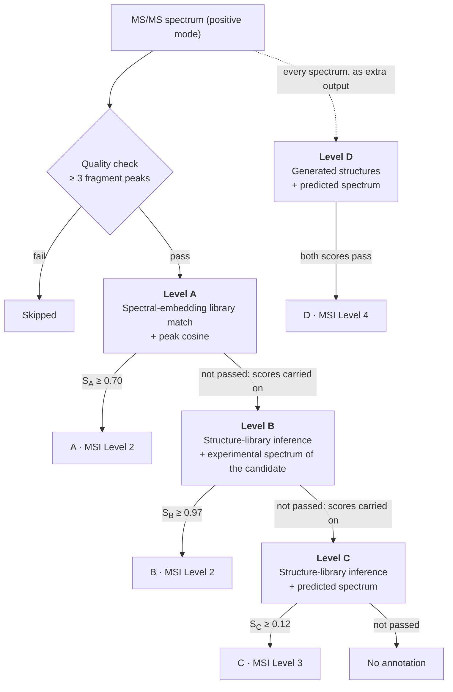

# Algorithm

## Main idea

Different kinds of evidence have different reliability. A match to an experimental reference
spectrum is stronger than a match to a predicted spectrum. A structure from a curated
database is more likely than a structure made by a generative model.

AnnoMASS therefore checks the evidence **in order, from the strongest to the weakest**.
Each spectrum stops at the **first level that passes**, and only the candidates of that level
are reported. The level tells you how much to trust the result.

Three design rules:

1. **Order by reliability.** Library evidence comes first. Predicted evidence is used only
   when library evidence is not enough.
2. **Scores are carried down.** When a candidate fails a level, its scores are not thrown
   away. They are passed to the next level and combined with the new evidence.
3. **Every level combines two kinds of evidence**: a score that finds candidates (a learned
   similarity or an inference score) and a direct comparison of peaks.

## Before the levels

**Quality check.** A spectrum needs at least 3 fragment peaks with ≥1% of the base-peak
intensity and more than 2 Da away from the precursor. Spectra with fewer peaks carry too
little information.

**Precursor mass.** Candidates must match the precursor *m/z* within 10 ppm. When the
precursor is written with few decimals, the rounding error is added to the tolerance.

**Flavonoid check.** Candidates are restricted to flavonoid structures, recognised by
substructure patterns of the flavonoid skeletons.

## Level A: spectral-embedding library match { #level-a }

**Question:** Is there an experimental reference spectrum that matches this spectrum?

**Spectral embedding.** A deep neural network (a transformer) was pre-trained on millions of
unannotated MS/MS spectra, without structure labels. It learned to turn each spectrum into a
vector of 1,024 numbers, an *embedding*. Spectra of similar molecules get similar vectors,
even when their peaks do not line up exactly (for example at a different collision energy or
on another instrument).

**Search.** The embedding of your spectrum is compared with the embeddings of a flavonoid
reference library (about 22,000 experimental spectra of about 1,700 compounds). The 20 most
similar library spectra within the precursor tolerance are kept.

**Peak cosine.** Each hit is also compared peak by peak with the *modified cosine*. This score
matches peaks directly and also peaks shifted by the precursor mass difference.

**Per compound.** A compound often has several library spectra (different energies,
instruments). AnnoMASS combines them and uses the best embedding similarity and the best
cosine of that compound. This uses all the spectra of a compound, not just one lucky match.

$$
S_A = 0.8 \cdot s_\text{embedding} + 0.2 \cdot s_\text{cosine}
$$

**Pass:** \(S_A \ge 0.70\) → level A, MSI Level 2.

Stereoisomers (same planar structure) share the score and are ordered by their own cosine and
embedding similarity.

## Level B: structure-library inference with an experimental spectrum { #level-b }

**Question:** If the exact spectrum is not in the library, which database structure is most
likely, and does an experimental spectrum confirm it?

**Structure inference.** The idea: molecules with similar spectra usually have similar
structures.

1. Your spectrum is compared with a large set of reference spectra using a learned spectral
   similarity. This similarity treats peaks and mass differences like words in a sentence and
   learns which ones tend to appear together.
2. The most similar reference spectra and their known structures are taken as "neighbours".
3. Every structure in the flavonoid structure database (about 17,500 structures) with the right
   precursor mass is scored by how similar it is to these neighbours (structural similarity,
   weighted by spectral similarity). A formula score is added.

This gives an **inference score** \(s_\text{inference}\) for every candidate. It can rank
compounds that have no spectrum in any library.

**Experimental confirmation.** If a candidate also has experimental spectra in the reference
library, the best peak cosine to those spectra is added. The embedding similarity carried
from level A is also used.

$$
S_B = 0.5 \cdot s_\text{inference} + 0.2 \cdot s_\text{cosine} + 0.3 \cdot s_\text{embedding}
$$

**Pass:** \(S_B \ge 0.97\) → level B, MSI Level 2.

The threshold is strict on purpose. In practice most spectra that fail level A do not stop at
B. Level B then mainly passes its combined score down to level C.

## Level C: structure-library inference with a predicted spectrum { #level-c }

**Question:** Without any experimental spectrum of the candidate, does its *predicted*
spectrum fit?

**Fragmentation prediction.** A graph neural network reads the structure of a candidate
and predicts its MS/MS spectrum. It works in two steps:

1. It breaks bonds of the molecule step by step and builds a tree of likely fragments.
2. It predicts the intensity of each fragment.

The predicted spectrum is compared with your spectrum by cosine similarity, after the same peak
cleaning on both sides (peaks below 1% of the base peak removed, at most 80 peaks).

$$
S_C = 0.5 \cdot S_B + 0.5 \cdot s_\text{predicted}
$$

\(S_B\) is the score carried from level B. All candidates go into C, including those that
failed B. For a candidate without library evidence, \(S_B\) contains only the inference score.

**Pass:** \(S_C \ge 0.12\) → level C, MSI Level 3.

Level C is MSI Level 3 because a predicted spectrum supports the structure class and the
substitution pattern, but cannot prove the exact isomer.

## Level D: generated structures { #level-d }

**Question:** What if the true compound is in no database at all?

**Generative model.** A *chemical language model* (a recurrent neural network that writes
molecules as SMILES strings) was first trained on general chemical space and then fine-tuned
on about 16,000 known flavonoids. It learned what flavonoid structures look like.

**Candidate pool.** The model was sampled 50 million times. The generated molecules were
filtered: valid chemistry, a flavonoid core, generated often enough to be plausible, and **not
already in the structure database**. About 8,500 structures remain. The pool is made once in
advance; your spectrum is not an input of the model.

**Scoring.** Pool structures that match the precursor mass (10 ppm) get a predicted spectrum
(as in level C). Two scores compare it with your spectrum: cosine similarity and spectral
entropy similarity.

**Pass:** the same structure must be ranked first by both scores, and one score must be
≥ 0.5 while the other is ≥ 0.4 → level D, MSI Level 4.

Level D runs for every spectrum and is reported as **extra output**. It never changes the
level or the ranking of A–C results.

!!! note "What level D means"
    A level D result is a structure hypothesis. Generated structures have no
    stereochemistry. "Not in the database" does not mean "new to science".

## Final steps

**Substituent-position check.** Many flavonoids differ only in where a sugar or a methoxy
group is attached. A library of diagnostic fragment ions for flavonoid substitution patterns
is used to check the top candidates. A lower-ranked candidate can move up only if it is in the
same level and its score is within 0.02 of rank 1. This changes only near ties.

**Merging and Top-K.** The same compound found by several spectra is merged into one row (can
be turned off). The top candidates per spectrum are reported (3 in the GUI and the web version).

**Retention time (optional).** A graph neural network trained on a large public
retention-time data set can add a predicted retention time. It is for information only and
is not used for ranking.

## Confidence levels

| Level | Evidence | MSI level |
|:---:|---|:---:|
| A | Experimental reference spectrum of the compound | 2 |
| B | Inferred database structure + experimental spectrum of the candidate | 2 |
| C | Inferred database structure + predicted spectrum | 3 |
| D | Generated structure + predicted spectrum | 4 |

MSI levels follow Schymanski et al. (2014). AnnoMASS never gives Level 1, which needs an
authentic standard measured under the same conditions.

## Parameters

| Level | Score | Threshold |
|:---:|---|:---:|
| A | \(0.8\,s_\text{embedding} + 0.2\,s_\text{cosine}\) | 0.70 |
| B | \(0.5\,s_\text{inference} + 0.2\,s_\text{cosine} + 0.3\,s_\text{embedding}\) | 0.97 |
| C | \(0.5\,S_B + 0.5\,s_\text{predicted}\) | 0.12 |
| D | cosine and entropy: same Top-1 | one ≥ 0.5, the other ≥ 0.4 |

These are the default values used in all published results. They can be changed in the
[command line](cli.md) for method development, but results with other values are not
comparable.

## Limits

- Only flavonoids and only positive mode.
- Isomers with almost identical spectra (for example flavanone and chalcone pairs) cannot
  always be separated by MS/MS. Use retention time.
- Level C and D results depend on predicted spectra. They are hypotheses to check, not
  identifications.
